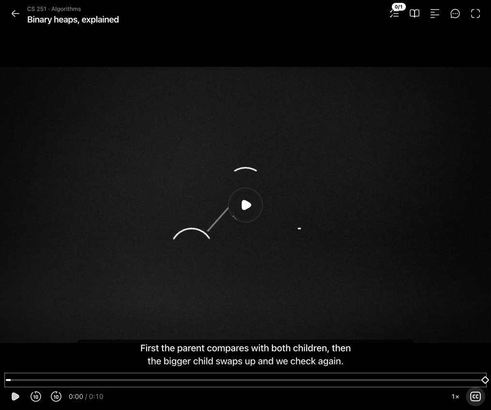

<div align="center">


# Tangent

Turn a textbook section into a narrated, animated video. Pause it any time and ask a question.

[](LICENSE)
[](https://github.com/monishramj/tangent/releases)


</div>

I built Tangent because I kept zoning out on dense textbook chapters, and I wanted something that explained them the way a good tutor would. You give it a PDF, slides, a Word file or a photo of notes and pick a section. It writes a script meant to be heard, reads it out loud, and animates it on screen. If something doesn't click, you pause and ask, and it answers about the scene you're on. Then you pick the video back up.

It's a beta. I've only tested it by hand on macOS. Windows and Linux installers get built, but nobody has run them yet, so expect rough edges there.

## Install

Grab the installer for your system from [Releases](https://github.com/monishramj/tangent/releases).

**macOS** (Apple Silicon or Intel): open the `.dmg` and drag Tangent to Applications. The app is signed ad hoc and not notarized, so macOS may refuse to open it. If that happens, try to open it once, then go to System Settings, Privacy & Security, and click Open Anyway. You can also run `xattr -dr com.apple.quarantine /Applications/Tangent.app`.

**Windows** (x64): run the `-setup.exe` or the `.msi`. It's unsigned, so SmartScreen will warn you. Click More info, then Run anyway.

**Linux** (x64): use the `.AppImage` (`chmod +x` it first), or install the `.deb` or `.rpm`.

## First launch

The first time you open it, Tangent downloads its Python runtime, document tools and voice model. That's about 2 to 3 GB, and if you cancel or retry it keeps what it already got.

You also need [Claude Code](https://code.claude.com) installed and logged in. Tangent calls the `claude` command to write scripts and answer questions, so there's no API key to set up. A "Before you start" screen checks this for you.

There's no local-model option yet. I've sketched a provider interface for something like Ollama, but nothing works end to end, so the app doesn't offer it.

I'm still reading Anthropic's terms to make sure an app like this is fine to distribute. My notes are in [docs/open-source.md](docs/open-source.md).

## How it works

```
PDF / PPTX / DOCX / photo
  -> sections (Docling)
  -> script written for speech (Claude Code)
  -> math and numbers made speakable, checked against the source
  -> narration (PocketTTS) and word-level timing
  -> animated scenes from templates
  -> player on one audio clock, with the tutor for your questions
```

Scenes stream in, so playback starts as soon as the first one is ready. Saved videos replay without calling the model again. Animations are tied to the spoken words, and things like arrays and trees are computed rather than drawn from memory. Typed questions stay as threads you can come back to, and a side panel shows the part of the book the narration is on. If you add a GIPHY key in Settings you get reaction GIFs, otherwise those show as text cards.



Under the hood it's a Tauri app (Rust) with a React and PixiJS front end and a Python sidecar run through `uv`. The animation engine is in `packages/motion`, and notes on each area are in [docs/areas](docs/areas/).

## Privacy

Parsing and narration run on your computer. The only thing that leaves it is the text the `claude` command needs to write a script or answer a question, and that goes through your own Claude account. No textbook or course material is included in this repo or the installers, so bring your own files. Tangent doesn't store API keys. If you add a GIPHY key, it's kept in a file only your user can read.

## Development

You need [bun](https://bun.sh), [uv](https://docs.astral.sh/uv/), Rust, and a logged-in `claude`.

```sh
bun install
bunx tauri dev
```

Tests and how I check changes are in [docs/testing-and-ci.md](docs/testing-and-ci.md). Release steps are in [docs/release.md](docs/release.md), and my project notes are in [CLAUDE.md](CLAUDE.md).

## Roadmap

I'm still working toward a first public beta. After that I want MP4 export, an editor for tweaking videos, a usage meter, and Klipy GIFs.

## Credits

Tangent stands on [Docling](https://github.com/docling-project/docling), [PocketTTS](https://github.com/kyutai-labs/pocket-tts), [PDFium](https://pdfium.googlesource.com/pdfium/), [Tauri](https://tauri.app), [PixiJS](https://pixijs.com), [React Bits](https://reactbits.dev), [Hugeicons](https://hugeicons.com), [KaTeX](https://katex.org) and [Motion](https://motion.dev). Licences are listed in [THIRD_PARTY_NOTICES.md](THIRD_PARTY_NOTICES.md).

## License

[MIT](LICENSE) © 2026 Monish Ramesh J
