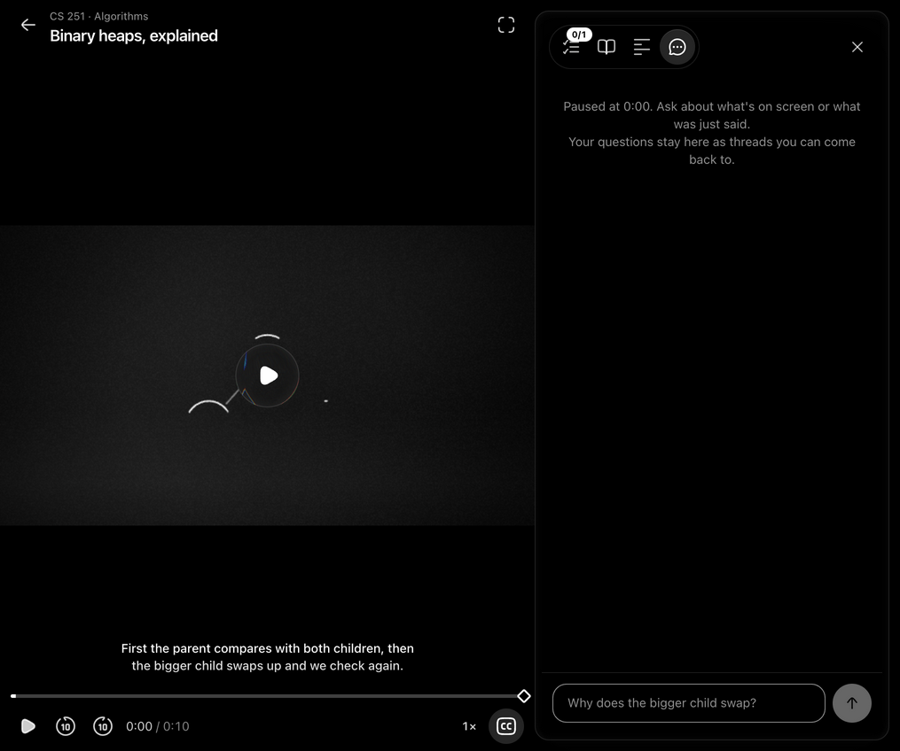

<div align="center">


# Tangent

Turn a textbook section into a narrated, animated video. Pause it any time and ask a question.

[](LICENSE)
[](https://github.com/monishramj/tangent/releases)




</div>

Tangent takes a textbook PDF, slide deck, Word file or photo of notes and turns a section into a narrated, animated video. The script is written to be heard, the narration is generated locally, and the animation is timed to the spoken words.

Pause at any point to ask a question. The tutor answers about the scene on screen, then you resume the video.

> **Beta.** Tested by hand on macOS only. Windows and Linux installers are built but have not been run on those systems.

## Install

Grab the installer for your system from [Releases](https://github.com/monishramj/tangent/releases).

**macOS** (Apple Silicon or Intel): open the `.dmg` and drag Tangent to Applications. The app is signed ad hoc and not notarized, so macOS may refuse to open it. If that happens, try to open it once, then go to System Settings, Privacy & Security, and click Open Anyway. You can also run `xattr -dr com.apple.quarantine /Applications/Tangent.app`.

**Windows** (x64): run the `-setup.exe` or the `.msi`. It's unsigned, so SmartScreen will warn you. Click More info, then Run anyway.

**Linux** (x64): use the `.AppImage` (`chmod +x` it first), or install the `.deb` or `.rpm`.

## First launch

On first launch Tangent downloads its Python runtime, document tools and voice model, about 2 to 3 GB. Cancelling or retrying reuses what has already downloaded.

[Claude Code](https://code.claude.com) must be installed and logged in. Tangent calls the `claude` command to write scripts and answer questions, so no API key is needed. A "Before you start" screen checks this.

Local models such as Ollama are not supported yet. A provider interface exists, but no local provider works end to end, so the app does not offer one.

Whether distributing an app that runs on a user's Claude Code login is permitted is still being checked against Anthropic's terms. See [docs/open-source.md](docs/open-source.md).

## How it works

```
PDF / PPTX / DOCX / photo
  -> sections (Docling)
  -> script written for speech (Claude Code)
  -> math and numbers made speakable, checked against the source
  -> narration (PocketTTS) and word-level timing
  -> animated scenes from templates
  -> player on one audio clock, with the tutor for your questions
```

Scenes stream in, so playback starts once the first is ready. Saved videos replay without further model calls. Visuals such as arrays and trees are computed rather than drawn from memory, a side panel follows the source text, and questions are kept as threads. Reaction GIFs need a GIPHY key in Settings; without one they show as text cards.


Tangent is a Tauri (Rust) app with a React and PixiJS front end and a Python sidecar run through `uv`. The animation engine is in `packages/motion`. Area notes are in [docs/areas](docs/areas/).

## Privacy

Parsing and narration run on your computer. Only the text the `claude` command needs to write a script or answer a question leaves it, through your own Claude account. No textbook or course material is included in this repository or the installers. Tangent stores no API keys; an optional GIPHY key is kept in a file readable only by your user.

## Development

Requires [bun](https://bun.sh), [uv](https://docs.astral.sh/uv/), Rust, and a logged-in `claude`.

```sh
bun install
bunx tauri dev
```

Testing is described in [docs/testing-and-ci.md](docs/testing-and-ci.md). Releases:  [docs/release.md](docs/release.md). Project notes: [CLAUDE.md](CLAUDE.md).

## Roadmap

The first public beta is in progress. Planned for v2: MP4 export, a video editor, a usage meter and Klipy GIFs.

## Credits

Built on [Docling](https://github.com/docling-project/docling), [PocketTTS](https://github.com/kyutai-labs/pocket-tts), [PDFium](https://pdfium.googlesource.com/pdfium/), [Tauri](https://tauri.app), [PixiJS](https://pixijs.com), [React Bits](https://reactbits.dev), [Hugeicons](https://hugeicons.com), [KaTeX](https://katex.org) and [Motion](https://motion.dev). Licences are listed in [THIRD_PARTY_NOTICES.md](THIRD_PARTY_NOTICES.md).

## License

[MIT](LICENSE) © 2026 Monish Ramesh J
