# Tangent UI review

Reviewed 2026-11-13 at `793975d`, on `monishramj/ui-review`. Recommendations only; no application changes.

Tangent already has a coherent black-and-white palette, strong video artwork, restrained copy, and a useful sources-first model. The main polish gap is the shell: large editorial headings, a decorative bookshelf, repeated page headers, floating glass, and hidden navigation make a working study library feel like a product landing page. The highest-value change is a compact, persistent desktop shell around the existing content—not another visual-effects pass.

## Evidence and limits

Used `nice -n 10 bunx vite --port 1440` and one Orca browser tab. Inspected `/`, Settings, `/src/dev/home-ui-check.html`, `/src/dev/home-design.html`, `/src/dev/showcase.html?reel=1` (sampled, not all 93 beats), and `/?showcase=tree`. Clicked folder navigation, folder menu/Escape, section selection, Original PDF, and all four player panel tabs. Read `src/home`, `src/player`, shared controls, `src/index.css`, Tauri window config and `docs/motion-identity.md`.

The player captures use the actual production `PlayerScreen`, mounted in browser memory through Vite module imports with one sample tree scene, one generated MCQ, and temporary silent WAV audio. The loading capture uses a pending stream. The temporary WAV was removed; no fixture or app code is committed. This verifies presentation, not generation, narration, tutoring, persistence, or native integration. The partly drawn tree in the paused player is an intentional capture at 0.1 seconds, not a rendering defect.

The ordinary Home error and Textbook page error are **expected without the Tauri bridge**. They demonstrate error presentation, not evidence that native file loading is broken. `home-ui-check` renders production components but has synthetic data and callback stubs; its zero-duration video is a fixture artifact. `home-design` is a separate concept, not the shipping UI. Screenshots are raw Orca PNGs: 1200×800 for initial Home/Settings, mostly 1015×848 after navigation, and an explicitly resized 800×600 checkpoint. Orca navigation reset the requested viewport; sizes here reflect captured pixels. Captures with incomplete browser repaints were discarded, not counted as app defects.

Priority: **P0** blocks comfortable core use; **P1** materially improves daily use; **P2** finishing work. Effort: **S** localized copy/style/control change, **M** one screen or shared interaction, **L** shell/state/native integration across screens. Effort is relative, not a delivery estimate. Proposed dimensions below are starting points for native validation.

## 1. Home / library

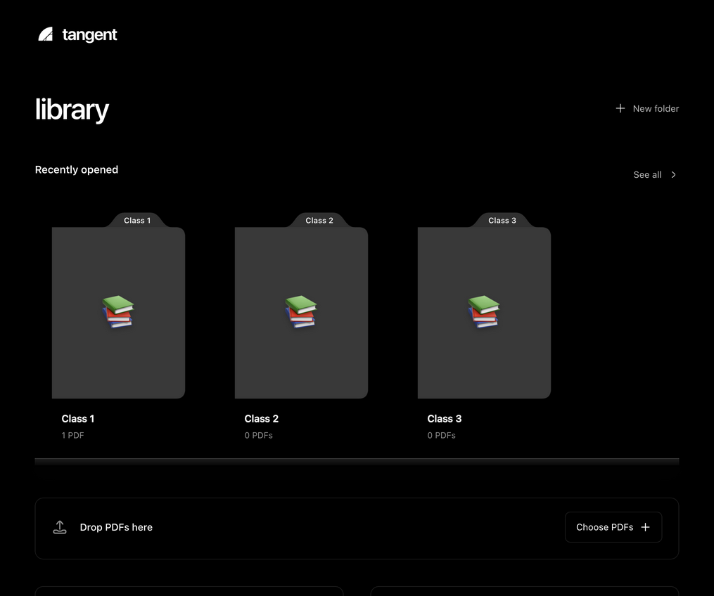

The folders occupy almost the entire first screen; recent videos are below the fold even with only three folders. The production code gives the header a 64 px bottom margin, the heading 42 px type, the shelf large vertical margins, and the lower two panels a 240 px minimum height. This creates a presentation hierarchy rather than a work hierarchy.

| What feels like a web page | Concrete recommendation | Priority / effort |
|---|---|---|
| Branding, hero heading and shelf dominate; the useful records start late. | Put Library, folder list and Settings in a collapsible 200–220 px navigation sidebar. Use a 48–56 px content toolbar with location and Import PDFs. Show recent/continue-watching videos and source rows immediately. Keep the player as a focused destination with a clear return location. | P1 / L |
| A permanent large dropzone interrupts ordinary browsing. | Keep a small Import PDFs toolbar action. Make the content area a drop target with an overlay only during a file drag. Retain a prominent dropzone for the truly empty library. | P1 / M |
| “Loose pages” sounds like pages extracted from a PDF; “Recently opened” actually contains folders. | Prefer “Unfiled PDFs” and “Recent folders”; keep normal-case navigational labels. The existing lowercase `library` is an owner decision—do not change capitalization incidentally in a spacing pass. | P2 / S |
| A growing library has no visible search or sort controls. | Add one local search over source/video titles and a simple Name / Recently opened sort. Use existing stored metadata; do not add recommendation feeds, study scores or analytics cards. | P1 / M |
| Empty sources and recent videos are equal-sized boxed panels. | Use compact section headings and rows on one content surface. Let content determine section height; keep boundaries only where they communicate navigation or selection. | P1 / S |

Reference: persistent navigation and a hierarchy-aware split view, following [Apple's sidebar guidance](https://developer.apple.com/design/human-interface-guidelines/sidebars). Linear's [favorites](https://linear.app/docs/favorites) are a useful reference for quick access to existing destinations; favorites themselves are optional, not part of the first pass.

## 2. Folders and organization

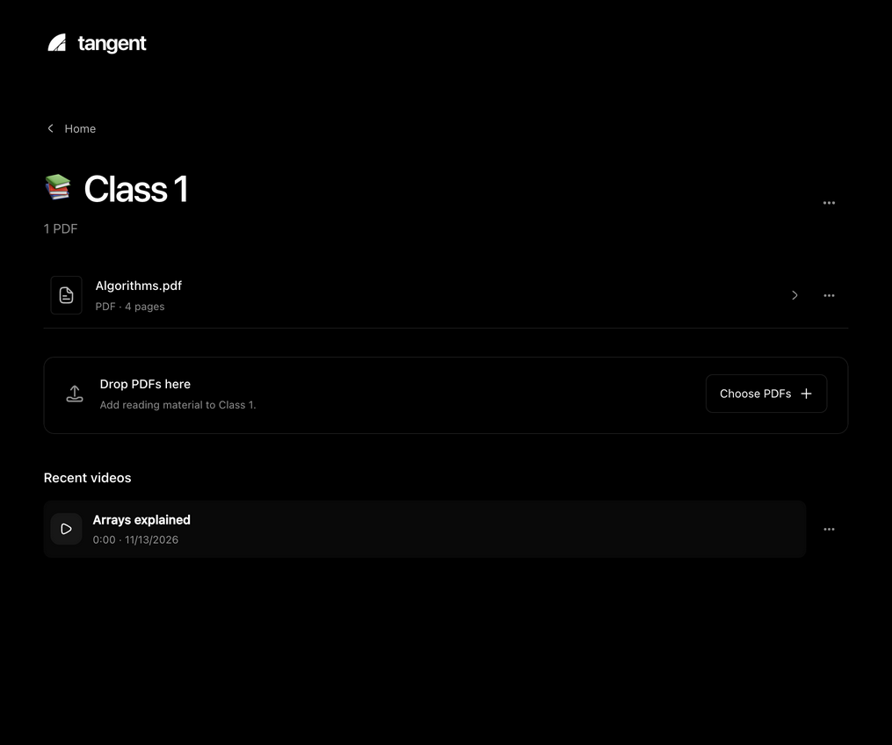

| What feels unfinished | Concrete recommendation | Priority / effort |
|---|---|---|
| Full-screen folder navigation removes all sibling context, repeats the wordmark and adds a separate Home row. | Keep selected folder highlighted in the sidebar; show its name/count in the toolbar. Preserve source selection and scroll when returning from a video. Until the shell changes, compress the existing header rather than creating another navigation layer. | P1 / M |
| Opening waits 460 ms for a decorative folder transition in `LibraryView.openFolder`. | Navigate immediately on activation; allow a brief opacity/selection transition without blocking clicks. Keep the book illustration as a small optional preview or empty-state illustration. Retain reduced-motion support. | P1 / S |
| Cover and caption are separate buttons to the same destination. | Make each folder one keyboard stop with one accessible name and a persistent selected state. Preserve the emoji as a small recognizable personal marker. | P1 / M |
| Moving a PDF is a select nested under an ellipsis, while other ellipses have different behavior. | Use a predictable menu: Open, Move to…, and applicable destructive actions. A small folder chooser can reuse the existing select. Include the current folder and “Unfiled PDFs”; confirm success locally. | P2 / M |

The [design preview](ui-review/08-design-preview.png) demonstrates warmer, more varied folder covers, but its slogan, shelf and generous whitespace intensify the landing-page impression. Reuse the personal identity, not that page's proportions.

## 3. Source view and section selection

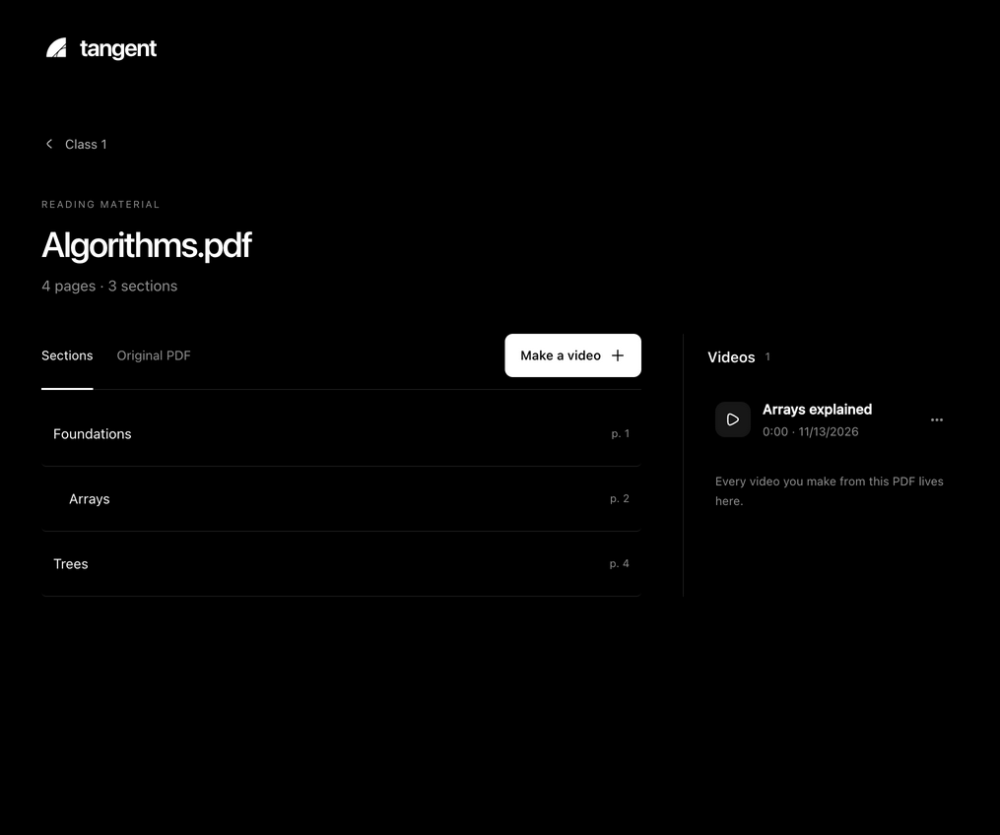

The source→sections→video relationship is understandable, and the dedicated saved-video list is worth retaining. Selection already has checkboxes, parent deduplication, select-all, explicit detail descriptions, keyboard tab navigation and focus restoration on Cancel. These are foundations to preserve.

| What feels like a web page / usability issue | Concrete recommendation | Priority / effort |
|---|---|---|
| Wordmark, back link, uppercase eyebrow, large filename and metadata consume roughly the first 330 px before the section toolbar. | Replace this stack with a compact breadcrumb/location row, 22–24 px document title and one metadata line. Start the section list near the top. Show full filenames in a tooltip or selectable details region when truncated. | P1 / S |
| Section rows have 22 px vertical padding and only indentation distinguishes hierarchy. Long books become a long page. | Target 36–44 px rows, add disclosure controls for chapters and preserve expansion state. Keep page numbers aligned; add section-title filtering for large outlines. Avoid forcing all chapters into cards. | P1 / M |
| “Make a video” opens a new selection mode; selection then moves the action to a large panel below. | Keep a consistent action location. Make selection available directly, with a compact bottom bar showing the effective selected count, detail level and “Make video.” Keep the existing parent/child deduplication and explain when children are included. | P1 / M |
| Pointer drag is advertised, but desktop range-selection conventions are not. | Support Shift-click ranges and keyboard selection with visible focus. Keep ordinary text fields immune to global shortcuts. Test mixed parent/child selections and a long scrollable outline. | P1 / M |
| Saved videos move below the source at the 850 px breakpoint. | Keep a compact “Videos (n)” destination or collapsible inspector at narrow widths so users know saved work exists; do not consume a permanent wide column for an empty list. | P2 / M |

### Original PDF

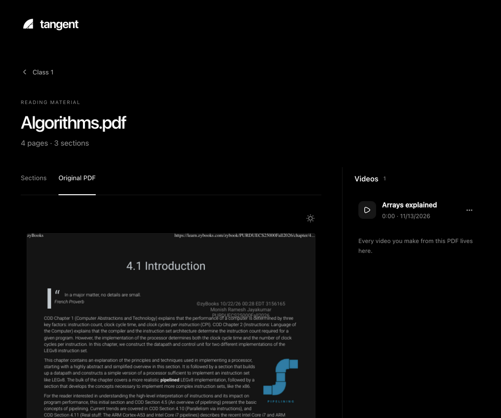

The document is pushed below a tall header and has a separate 70vh scroller inside the scrolling page. **P1 / M:** give the reader the remaining window height, one primary scrolling region, a page-number/jump control, and the same zoom/Fit width controls as Textbook. Keep original/dark colors explicit; inversion is useful for text but should not be presented as faithful figure colors. Preserve lazy page rendering and settled-resolution upgrades. A native document-reader toolbar is the reference pattern, rather than a large image embedded in a page.

## 4. Generation, loading and recovery

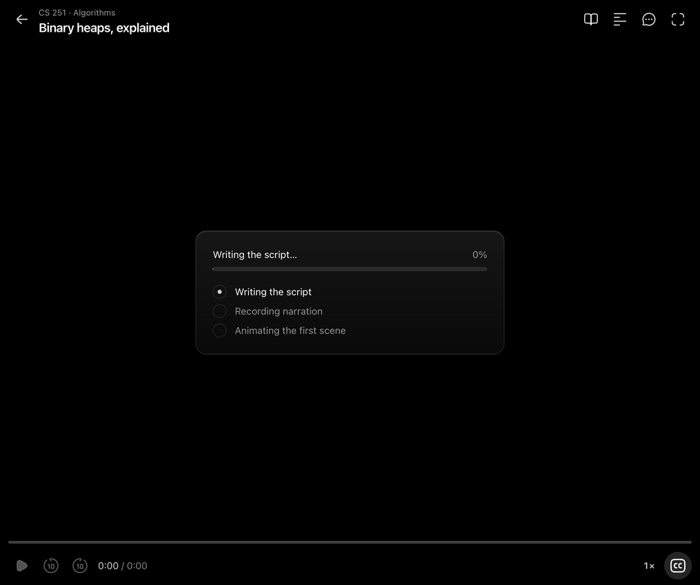

| What feels unfinished | Concrete recommendation | Priority / effort |
|---|---|---|
| A centered glass progress card and mostly inactive player chrome leave the user in an empty waiting room. | Show the selected section, a plain current-stage label, and one explicit action explaining how to leave/cancel. Hide inactive transport controls until there is playable content. | P1 / M |
| `Loading.tsx` displays a numerical percentage derived partly from elapsed-time estimates. | Show an indeterminate stage indicator until measurable progress exists. If retaining a percentage, label it Estimated; use real ready/total scene counts once available. Do not imply an exact completion time. | P1 / S |
| Progress language exposes “beats” and “scenes,” while the student chose textbook sections. | Use “Preparing your explanation” and “First part ready”; keep pipeline details in an expandable diagnostic area. Keep optional “Coming up” content short and stable. | P2 / S |
| Back navigation unmounts Generate and aborts its controller; it is not a background-generation workflow. | Label the action “Cancel generation” or explain cancellation before leaving when work would be lost. Do not promise that generation continues in the library unless session ownership is changed. Coordinate with the background queue worker; PDF parsing and video generation are distinct. | P1 / M |
| Later scene failures can be skipped while the library only says Partial. | Show a quiet “Video incomplete” result with available duration, what failed, and a retry action after playback. Keep already playable material accessible and distinguish saving failure from generation failure. | P1 / M |

## 5. Player header, controls and captions

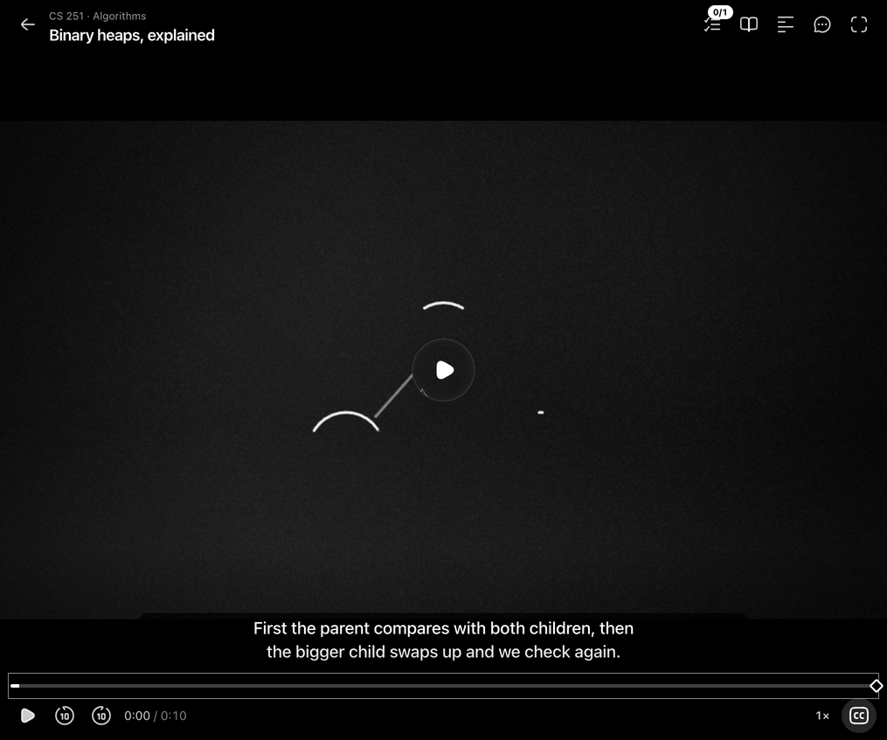

The stage's monochrome artwork feels more authored than the surrounding library. Keep its aspect ratio, audio-clock behavior, captions outside the canvas, and unobtrusive transport controls.

| What feels unfinished | Concrete recommendation | Priority / effort |
|---|---|---|
| Ask, the core product action, is one of several equally weighted unlabeled icons. Those icons relocate into the panel when it opens. | Give Ask a visible text label and stable location. Keep secondary tools in one consistent inspector header; show the selected panel's name, with icons as reinforcement. | P1 / M |
| Glass central play control introduces a glossy material absent from the drawn scene. | Use a simple translucent dark circle and white play icon. Keep blur confined to static shell surfaces and avoid a refraction treatment that differs between Chromium and WKWebView. | P2 / S |
| Seek markers are tiny and look similar at a glance. | Retain circle/diamond distinction but enlarge invisible hit targets, give keyboard focus a visible marker and expose checkpoint/question labels on focus as well as hover. | P1 / M |
| Time total grows during generation without a clear distinction from a final duration. | Label the available extent “Ready to 2:10” while streaming; switch to elapsed / total when complete. | P2 / M |
| Captions compete for the remaining lower area when a panel opens. | Reserve a predictable caption strip, constrain line length and check long mathematical narration at the smallest supported player width. Preserve CC preference and ensure captions remain readable with controls both shown and hidden. | P1 / M |

**P0 / M: compact-window behavior.** The Tauri configuration starts at 800×600. `SidePanel` is always docked, has a 320 px minimum and defaults to 400 px; the actual code does not implement the narrow floating behavior described in a PlayerScreen comment. At 800×600 the video column is approximately 388 px wide. A checkpoint inside its 16:9 region gets only about 218 px of height before its large fixed padding. This is a poor default for the app's core learning interaction.

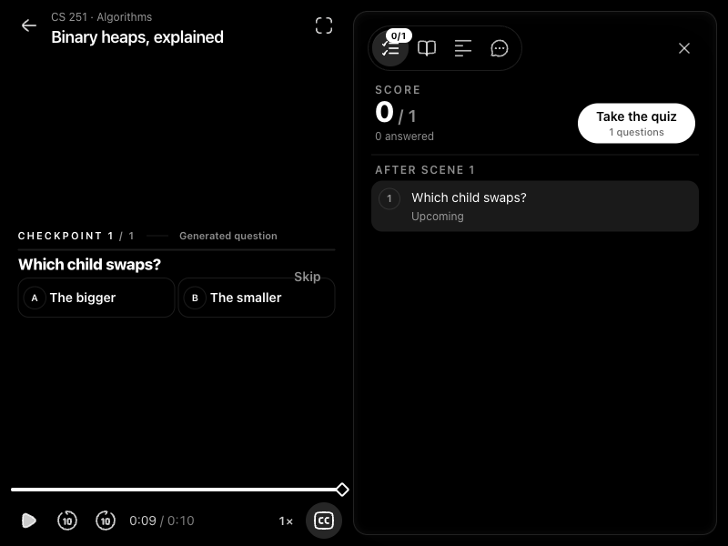

At narrow widths, present one primary study surface at a time: close/collapse the inspector when opening a checkpoint, or let the checkpoint occupy the available content height rather than the 16:9 canvas. For Ask/Textbook, use an intentional overlay or alternate view with a clear Back to video control below a measured minimum stage width. At larger widths, retain the useful resizable dock. Acceptance: the question, answer controls and Continue/Skip must remain reachable without a tiny inner scroll area at 800×600, with both short and long content. Raising the default window size alone does not fix resizing.

## 6. Side panel: Ask, Transcript, Textbook, Checks

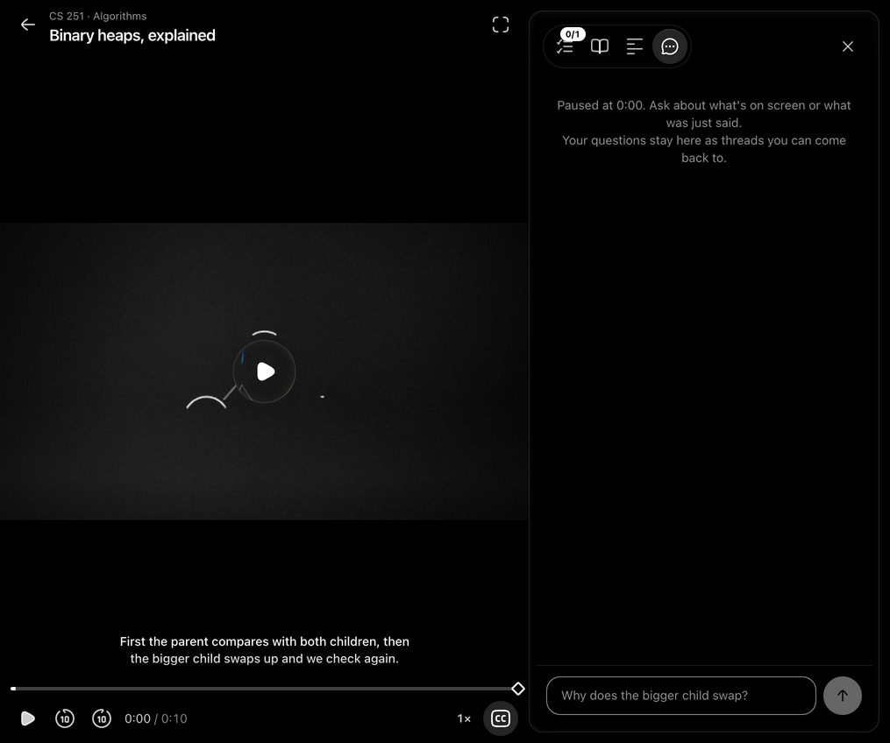

| Screen / what feels unfinished | Concrete recommendation | Priority / effort |
|---|---|---|
| Ask: large empty chat surface; example placeholder assumes a specific heap lesson. | Add a clear “Ask about this moment” heading, compact paused-time context and neutral placeholder “Ask a question…”. Keep the input pinned and the existing thread timestamps / Resume affordance. Do not add generic prompt chips unrelated to the current lesson. | P1 / S |
| Ask: reply failures look like ordinary tutor messages, while storage errors are silently swallowed in PlayerScreen. | Show a distinct retryable message state; retain the user's draft/question and distinguish “answer unavailable” from “couldn't save this conversation.” Never imply a reply was saved when it was not. | P1 / M |
| Transcript: `scrollIntoView` follows every new current line, with no manual-browsing pause like Textbook's. | Reuse the Textbook follow/free-scroll concept: scrolling suspends following, “Back to current” resumes it. Provide text selection/copy and a clear seek affordance; add search only after long transcripts demonstrate need. | P1 / M |
| Textbook: a second floating capsule houses zoom tools; page failures occupy a full page-shaped empty block. | Use a stable toolbar under the panel title; keep Fit width, page number and follow state visible. Put retry/relink actions beside a concise page failure, without replacing unrelated loaded pages. | P1 / M |
| Checks: animated score and “After scene 1” vocabulary make it feel like a dashboard widget rather than study review. | Keep the plain score and status marks; use section/segment labels when available. Label the action “Review questions,” retain generated/textbook provenance and distinguish unanswered from wrong. Fix singular “1 questions.” | P2 / S |
| All tabs: icon-only pill bar inside rounded glass has another layer of framing, and tab order puts Ask last. | Use a quieter inspector surface with a labelled active tab. Establish one order across closed/open states; put Ask first if interruption remains the primary workflow. Preserve current ARIA labels, tab arrow navigation and keyboard resize support. | P1 / M |

[Textbook browser-only error capture](ui-review/15-textbook-browser-error.png) shows the layout, not a native PDF defect. Actual PDF rendering was inspected in the production SourceView fixture. Highlighting, pinch calibration and native smoothness were reviewed in code, not verified on hardware.

[Checkpoint capture](ui-review/17-checkpoint.png): provenance and explicit Skip are good. **P1 / M:** make prompt text immediately readable instead of word-by-word blur, retain space for meaningful source imagery, and maintain one obvious primary action after grading. Test long answer choices, failed grading and keyboard focus in both the inline card and full Quiz; this review did not submit answers or call a tutor provider.

## 7. Settings

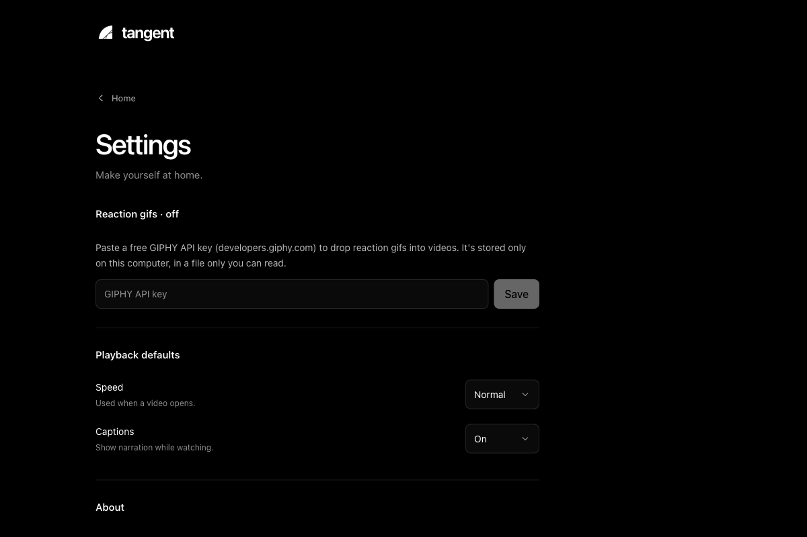

The dedicated Settings screen and shared form controls are improvements already present in this checkout. Preserve them; do not reintroduce Settings into the player inspector.

| What feels like a web page | Concrete recommendation | Priority / effort |
|---|---|---|
| A slogan and large title take priority over preferences; GIPHY credentials appear before playback defaults. | Use a compact Settings title, then Playback, optional Integrations, and About/Updates. Remove “Make yourself at home.” Keep short helper text attached to its control. | P1 / S |
| A two-state Captions preference is a select. | Use the existing accessible checkbox/toggle pattern with an explicit label; keep speed as a select. Align labels and controls in a restrained two-column form. | P2 / S |
| Settings is reached through a Home gear and always labelled Home on return. | Make Settings available through the app menu and Cmd+, and preserve the prior source/folder on return. A dedicated preferences window is optional later; a correctly behaving existing screen is sufficient. | P1 / M |
| Update/version content is split across About and Updates. | Consolidate the version, update status and Check for updates action. Keep install/restart explicit; use calm inline errors and progress. The browser guard is correct and should remain. | P2 / S |

No secrets were entered, settings changed, or updates installed during this review.

## 8. Empty/error states, dialogs and menus

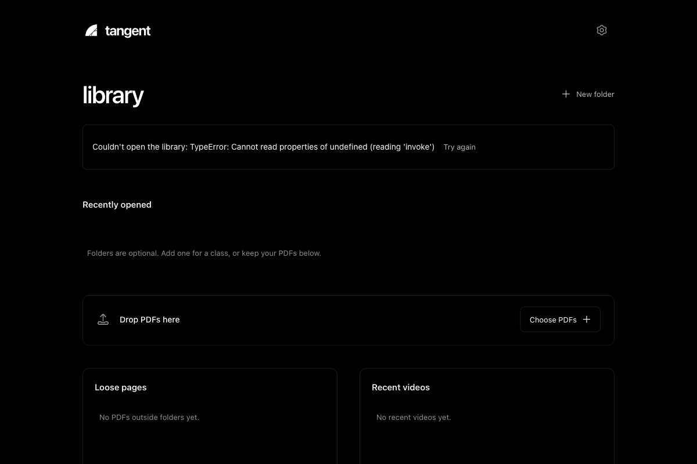

| What feels unfinished | Concrete recommendation | Priority / effort |
|---|---|---|
| Empty Home repeats three explanations in separate regions. | Show one useful first-run state: “Add a PDF to make your first video,” an Import PDFs action, and a quiet optional Create folder link. Introduce empty subsections after the user has content. | P1 / S |
| Error messages interpolate raw exceptions, including bridge/implementation details. | Lead with the failed action and recovery: “Couldn't open this library. Try again.” Put technical detail behind Copy details / disclosure. Preserve existing data on load failure and do not imply that the library is empty. | P1 / M |
| Video ellipsis directly opens delete confirmation; folder ellipsis opens a real menu; move ellipsis opens a form. | Standardize the trigger's meaning. Video ellipsis should open an actual menu, with Delete as a labelled item. Keep destructive confirmation specific to the named item. | P1 / M |
| Create/rename/delete forms expand inside page flow and can move content unexpectedly. | Use a small anchored popover or sheet with clear title, explicit Cancel, initial focus, Escape and focus return. Preserve validation, busy disabling and “PDFs stay in your library” deletion copy. Reuse the shared Menu where its semantics fit. | P2 / M |
| All scrollbars are globally hidden in `index.css`. | Respect system scrollbar visibility; retain normal scrollbars on long lists, transcript and PDF panes. This reveals overflow and offers a precise drag target. | P1 / S |

The folder menu opened and Escape closed it during inspection. Existing Menu keyboard handling and source-tab keyboard handling should be preserved, not replaced by styled divs. Full VoiceOver and focus-order auditing remains necessary before calling these interactions accessible end to end.

## 9. Desktop shell and macOS behavior

Evidence is configuration/code, not a native-window screenshot: `tauri.conf.json` specifies an 800×600 titled window, with no explicit overlay title bar or vibrancy setup. The reviewed React shell has no custom drag-region markup. This does **not** establish that native traffic lights or default system menus are absent; those are supplied outside this browser surface.

| Gap / recommendation | Priority / effort |
|---|---|
| Keep real macOS traffic lights and standard title-bar behavior. Integrate the compact toolbar visually with that chrome; do not draw imitation traffic lights. If adopting an overlay title bar, reserve native control space and make only inert toolbar background draggable—buttons, text selection and inputs must remain interactive. Verify double-click zoom and window dragging natively. | P1 / L |
| Provide app-specific menu commands and matching shortcuts: Settings, Import PDFs, navigation, playback, panel access and window controls. Preserve system Edit commands and native Full Screen/Hide/Quit behavior. The browser `requestFullscreen` path needs native validation; it is not proof of macOS window fullscreen parity. Coordinate with the menu/keybind workers rather than building duplicate bindings. | P1 / M |
| Restore window size and the last meaningful destination; keep breadcrumbs / sidebar selection consistent when opening videos and returning. Restore scroll without restarting ornamental entrances. | P1 / M |
| Consider subtle native vibrancy for the navigation sidebar only, with an opaque high-contrast fallback and Reduce Transparency handling. Keep the content/video area opaque. Material changes are secondary to density and navigation. | P2 / M |
| Make shortcuts discoverable through menu equivalents and a small searchable shortcuts reference. Avoid a command palette until the command set warrants it. Scope Space/arrows to the player and ignore editable controls. | P1 / M |

[Apple's macOS guidance](https://developer.apple.com/design/human-interface-guidelines/designing-for-macos) emphasizes menu-bar access and desktop interaction conventions. [Apple's toolbar guidance](https://developer.apple.com/design/human-interface-guidelines/toolbars) informs the compact command surface. Linear's [shortcut-help pattern](https://linear.app/changelog/2021-03-25-keyboard-shortcuts-help) is a useful discoverability reference; copy the principle, not its command inventory.

## 10. Typography, spacing, icons and motion identity

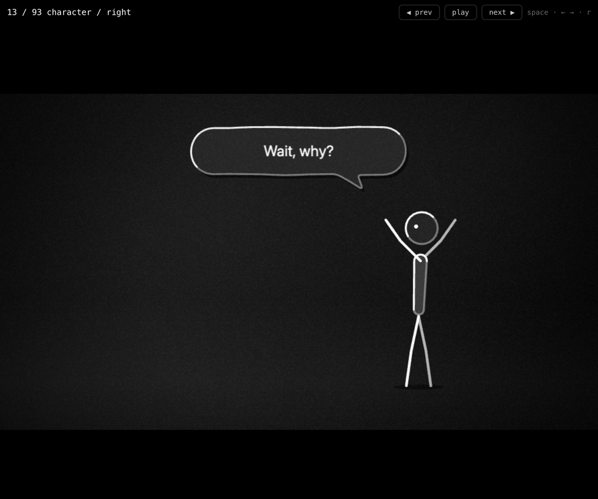

The approved [motion identity](motion-identity.md) describes confident drawn lines, tonal bodies, purposeful accent, and motion that establishes reading order. The app should share its palette and confidence without turning file navigation into a video scene. [Tree reference](ui-review/10-tree.png).

| Current inconsistency | Recommendation | Priority / effort |
|---|---|---|
| 42 px library headings and 36 px document headings coexist with 10–12 px metadata and 14 px working rows. | Use system sans throughout: proposed 22–24 px screen title, 14 px primary rows/body, 12–13 px metadata and 13 px controls. Keep large expressive type in the educational stage. Validate contrast on actual translucent surfaces, not black alone. | P1 / S |
| Wide empty margins coexist with crowded player tools. | Use a 4/8 px spacing rhythm, 16–24 px pane insets, compact toolbars, and 36–44 px working rows. Keep adequate hit areas and do not shrink controls merely to fit a broken layout. | P1 / M |
| Library rectangles, circular transport controls, pill tabs, glass panels and perspective covers all compete. | Keep three roles: plain content rows, subtly raised utility surfaces, and circular transport controls. Use borders for meaningful separation; remove stacked decorative frames. Reuse existing shared control components rather than importing another UI kit. | P1 / M |
| White is simultaneously text, primary action, selection and progress. | Keep neutral grays for hierarchy; use the motion identity's amber only for a meaningful current/focus/result state if adopted in the shell. Do not add decorative gradients or multiple semantic colors without need; distinguish status with words/shapes too. | P2 / S |
| Hugeicons are consistent in family but size and framing vary. | Standardize 16–18 px row icons and 20–22 px toolbar icons, optical alignment and stroke treatment. Keep folder emoji small and user-specific. Label ambiguous commands; do not replace all icons with another library. | P2 / S |
| Shine, blur reveals, hover scaling, shelf opening and page entrances accumulate. | Limit routine UI transitions to roughly 120–180 ms opacity/color; use 180–240 ms for a panel reveal when useful. No deliberate navigation delay, looping shine on passive labels or stagger on ordinary file rows. Keep the stage's draw/fill/land and narrative timing intact. | P1 / M |
| CSS reduced-motion overrides do not automatically cover JS-driven motion or imperative smooth scrolling. | Audit each JS animation and scroll-follow path separately, including BlurText, Folder, Transcript and Quiz. Preserve existing MotionConfig and reduced-motion behavior; verify in native system settings. | P1 / M |

## Verification and handoff

- TypeScript: `nice -n 10 ./node_modules/.bin/tsc --noEmit` passed.
- Full Vitest: `nice -n 10 ./node_modules/.bin/vitest run --maxWorkers=2`: **65 files passed, 1 skipped; 911 tests passed, 1 skipped**. Existing jsdom canvas warnings were emitted.
- Production build: `nice -n 10 bun run build` passed (TypeScript + Vite); Vite emitted its large-chunk warning, with the main JS chunk approximately 7.9 MB before gzip. No bundle changes were made.
- No Rust changed; cargo tests and native app build intentionally omitted. No dependency install was needed. Heavy checks ran sequentially; Vite was stopped through Orca with `ptyKilled: true` before tests/build.
- No code changes, new dependencies, design-system rewrite, provider calls, update installs or commits to app code. Recommendations are not fixes or usability-study results.
- Native follow-up: traffic lights/dragging, menu equivalents, actual WKWebView blur fallback, VoiceOver, reduced motion/transparency, real long-PDF reading, audio sync, generation recovery and 800×600 study flows.
- Owner decisions to settle during implementation: retain a small shelf preview or remove it; keep pure monochrome shell or use amber for current state; compact inspector overlay versus alternate study view. None blocks this review.
- Parallel-work boundary: Settings, folder motion, keybinds, parsing queue and future native menu work may already address individual findings. Recheck each against the coordinator's integrated branch before implementing; this document describes the reviewed commit only.

## Top 10, ranked

1. **P0 / M — Fix the 800×600 study layout.** Collapse/overlay the inspector or let checkpoints use the available height; keep question and actions usable.
2. **P1 / L — Establish a persistent desktop shell.** Compact toolbar, clear location and collapsible folder navigation; preserve return context.
3. **P1 / S — Recover the first screen for content.** Compress library/source headers and shelf, remove forced empty-card height, expose useful records above the fold.
4. **P1 / M — Make Ask and inspector navigation explicit.** Label the core action and selected tab, keep their locations/order predictable.
5. **P1 / M — Make section selection work like a desktop list.** Compact hierarchy, range selection, stable action bar and effective-selection count.
6. **P1 / M — Make generation status honest and actionable.** Estimated versus measured progress, explicit cancel/leave behavior and a clear partial-result state.
7. **P1 / M — Integrate native commands and shortcuts.** Settings/Import/navigation/playback through one command model; preserve macOS conventions.
8. **P1 / M — Make long reading controllable.** One useful PDF scrolling region, consistent zoom, transcript follow pause and visible scroll affordances.
9. **P1 / M — Standardize recovery and menus.** Plain-language errors, retry/save status, predictable ellipses and item-specific destructive confirmation.
10. **P1 / M — Reduce ornamental motion and unify working controls.** Immediate navigation, stable text, consistent type/spacing and verified reduced-motion behavior; preserve the video's distinct motion identity.
